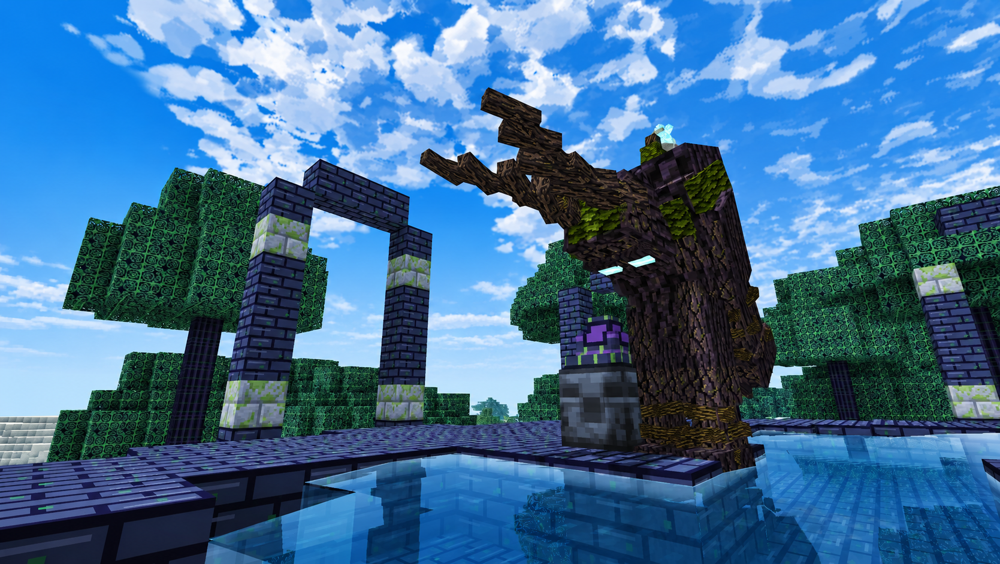
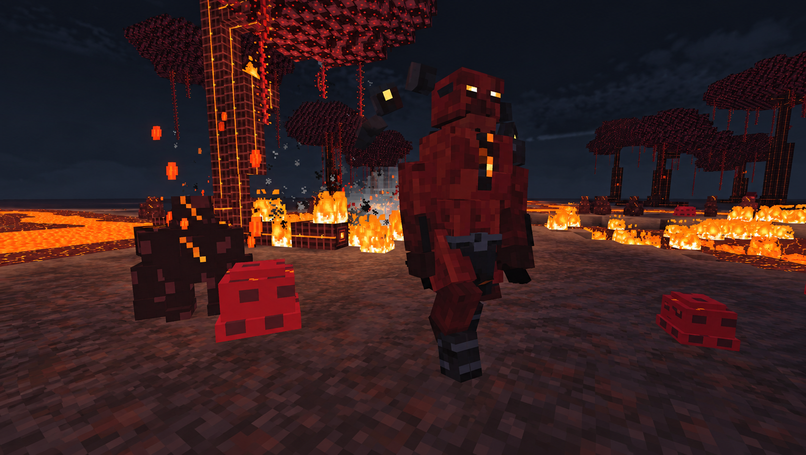
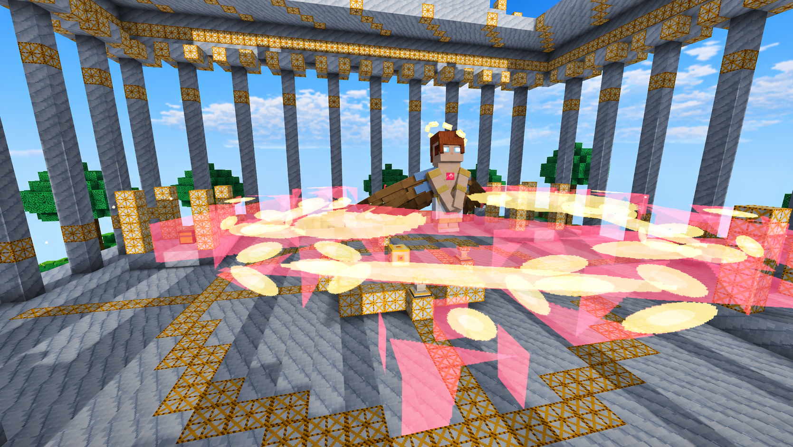

<p align="center"></p>

# Exotron

**Світ після штучного інтелекту.** Пригодницький мод із власною історією для **Minecraft Java 1.20.1 · Fabric**, також відомий як **Opus Vs EXE**. Досліджуйте сліди Великої війни, знаходьте метал, що зберігає пам'ять, і повертайте забуті технології проти машин.

[English](README.md) · **Українська** · [Русский](README.ru.md)

[CurseForge](https://www.curseforge.com/minecraft/mc-mods/exotron-beta) · [Modrinth](https://modrinth.com/mod/exotron-beta) · [Planet Minecraft](https://www.planetminecraft.com/mod/exotron-beta/) · [BuiltByBit](https://builtbybit.com/resources/exotron.127909/) · [Повідомити про помилку](https://github.com/Irisko007/Exotron/issues)



> **Бета · версія вихідників 1.0.0.** Тут збережено надану копію коду розробки. Окремо опублікований JAR може мати інший набір увімкненого контенту. Каталог крафтів точно відповідає цьому репозиторію, зокрема рецептам, залишеним для сумісності.

## Що є в моді

| Напрям | Що досліджуємо | До чого рухаємося |
| :--- | :--- | :--- |
| Opus і Haiku | Лабораторії, зруйновані міста, фортеці, цитадель і колізей | Очищення Опуса, сильніші машини та Haiku Omega |
| Fire Realm | Вулканічні землі, жарокапоки й Чотири Жили | Жильне спорядження, Diablo та його вибуховий тризуб |
| Paradise Island | Небесний острів, місцева фауна й Парфенон | Польоти на виверні, небесне спорядження й Angel Boy |
| Dark Forest | Gloomwood, місячні квіти й Місячний фонтан | Лісове спорядження та Mossbound |
| Поселення | Поселення вцілілих і японське поселення | Торгівля, дослідження, самураї та їхня зброя |

- П'ять керованих **EXO**: енергія, відсіки спорядження та власні здібності.
- Машини Haiku, регіональні істоти й боси з фазами, попередженнями про атаки та повторними викликами.
- Зброя й інструменти з активними здібностями, бонуси комплектів броні та власні 3D-моделі.
- **Opus Assembly Table 5×5**, **Parthenon Forge 3×3** і очищення металу в **Resonance Forge**.
- Фрагменти пам'яті, експедиційні компаси, трофеї та екран **Хронік мода** з досягненнями.
- Окремі клієнтські й серверні частини та необов'язкова інтеграція JEI з перенесенням рецептів.

<p> </p>

## Історія

Брати Кімі та Кодді відкривають **Опус** — метал, здатний зберігати спогади. Кімі створює на його основі штучний інтелект Haiku. Згодом машина вчиться відтворювати метал і вдосконалювати себе. Страх, зрада та загибель творців стають початком Великої війни.

Гравець знаходить те, що залишилося: незавершені креслення EXO, машини, розкидані спогади та місця, які досі пам'ятають війну. Основний канон: [lore/lore.md](lore/lore.md). Fire Realm має окрему [паралельну історію](lore/Fire%20Biom/LOR.md).

## Установлення

Потрібна **Minecraft Java Edition 1.20.1** із Fabric. Значення нижче взято з `fabric.mod.json` і `gradle.properties` цієї копії коду.

| Компонент | Вимога |
| :--- | :--- |
| Minecraft | Java Edition **1.20.1** |
| Java | **17 або новіша** для запуску; **JDK 17** для описаної збірки |
| Fabric Loader | **0.19.5 або новіший** |
| Fabric API | **0.92.12+1.20.1 або новіша сумісна версія для 1.20.1**; установлюється окремо |
| GeckoLib | **4.4.9**, вбудовується під час Gradle-збірки через `include` |
| JEI | Необов'язково; інтеграція компілюється з API **15.49.0.200** |

1. Установіть профіль Fabric для Minecraft 1.20.1.
2. Завантажте JAR Exotron та сумісний JAR Fabric API. Покладіть обидва у `mods` потрібного ігрового профілю.
3. Запустіть профіль Fabric. Для спільної гри використовуйте однакові версії модів на клієнті й сервері.
4. У налаштуваннях керування перевірте конфлікти клавіш, особливо `L` та здібностей EXO.

Для готового релізу орієнтуйтеся на його власні залежності. JAR, зібраний тут, містить GeckoLib: друга копія не потрібна, якщо цього не вимагає конкретна опублікована збірка. Де знайти папку `mods`, пояснює [інструкція Fabric](https://docs.fabricmc.net/players/installing-mods).

## З чого почати та як керувати

Досліджуйте структури, шукайте матеріали Опуса й фрагменти пам'яті. В активній Resonance Forge очищуйте метал: **Raw → Stabilized → Resonant → Core Opus**. Зберіть стіл 5×5, потім ядра активації та раму EXO. Fire Realm, Paradise Island і Dark Forest мають власні шляхи розвитку спорядження.

| Стандартна клавіша | Дія |
| :---: | :--- |
| **L** | Відкрити **Хроніки мода**: нові досягнення та прогрес |
| **F / G / H / J** | Здібності EXO 1 / 2 / 3 / ультимативна, якщо їх підтримує модель |
| **R** | Відсіки спорядження EXO |
| **B** | Резонансний удар EXO |
| **V** | Здібність спорядження: ударна хвиля / ураган / тіньовий крок залежно від комплекту |

Клавіші можна змінити в налаштуваннях. Для здібностей потрібні відповідне спорядження, енергія та завершення перезарядки. **Демонічний тризуб** випадає з Diablo: затисніть використання, відпустіть для кидка — снаряд вибухне при влучанні й повернеться до власника.

## Усі крафти

| Формат | Мови | Зміст |
| :--- | :--- | :--- |
| [CRAFTING.md](CRAFTING.md) | Українська | Повний каталог із рівними сітками |
| [CRAFTING.en.md](docs/CRAFTING.en.md) | Англійська | Ті самі рецепти та кількість інгредієнтів |
| [CRAFTING.ru.md](docs/CRAFTING.ru.md) | Російська | Ті самі рецепти та кількість інгредієнтів |
| [recipes.html](docs/recipes.html) | Перемикання трьох мов | Іконки, пошук, фільтр станцій, друк і PDF |

**153 JSON-рецепти:** 61 фігурний, 72 безформні, 6 рецептів складання та 14 рецептів Парфенона. Також є всі **три перетворення Resonance Forge** й пояснення складання EXO. Звичайні рецепти показано сіткою 3×3, складальні — повною сіткою 5×5. Один символ — одна комірка; назви, ID та кількість наведено нижче. Ruby Halo Shard у ковальських рецептах Парфенона повертається після крафту.

Також додано наявний [ілюстрований довідник](docs/index.html) та [посібник із проходження](docs/guide.html). Після завантаження репозиторію відкривайте HTML локально. Старі записи довідника можуть описувати збережений у коді контент, який не ввімкнений у конкретному релізі.

## Збірка з коду

Установіть **JDK 17** і спрямуйте на нього `JAVA_HOME`. Gradle wrapper завантажить **Gradle 8.10.2**. Першій збірці потрібен інтернет для Minecraft, Fabric, GeckoLib та API JEI, що використовується лише під час компіляції.

```sh
git clone https://github.com/Irisko007/Exotron.git
cd Exotron
chmod +x gradlew
./gradlew build
```

У Windows: `gradlew.bat build`. Готовий мод: **`build/libs/opusvsexe-1.0.0.jar`**. Файл `-sources.jar` призначений для розробників, його не треба встановлювати у гру.

```sh
./gradlew runClient       # клієнт для розробки
./gradlew runServer       # сервер для розробки; спочатку прийміть його EULA
```

Перевірки ресурсів і документації потребують **Python 3.10+**, без сторонніх пакетів:

```sh
python3 scripts/validate_resources.py
python3 docs/validate_docs.py
python3 scripts/generate_recipe_book.py --check
```

Після зміни рецептів оновіть обидва каталоги:

```sh
python3 docs/generate_catalog.py
python3 scripts/generate_recipe_book.py
```

Деяким допоміжним генераторам графіки потрібні додаткові Python-інструменти; для Gradle-збірки вони не потрібні.

## Структура проєкту

```text
src/main/java/       Механіки, реєстри, істоти, станції, мережевий обмін
src/client/java/     Рендер, екрани, клавіші, інтеграція JEI
src/main/resources/ Моделі, текстури, анімації, звук, рецепти, генерація світу
docs/               Довідники та згенеровані каталоги крафтів
lore/               Канон основної історії та Fire Realm
scripts/            Генератори й перевірки ресурсів та документації
pack/               Додаткові авторські ресурси датапака
concepts/           Збережені рішення з дизайну й реалізації
gradle/             Gradle wrapper
```

Для сумісності збережено ID **`opusvsexe`** і Java-простір **`com.opus`**. Джерело рецептів для генераторів — `src/main/resources`; саме це дерево ресурсів потрапляє у збірку.

## Команда та участь у розробці

Exotron створила **команда студентів**, щоб познайомитися з Java на практиці. Істоти, предмети, інтерфейси й окремі ігрові системи дали змогу попрацювати з класами, успадкуванням, інкапсуляцією та зв'язками між частинами програми. Досвід організації великого проєкту стане в пригоді й в інших мовах.

Для помилки [створіть issue](https://github.com/Irisko007/Exotron/issues): укажіть версії Minecraft, Fabric і мода, кроки відтворення та потрібний фрагмент журналу. Перед змінами прочитайте [CONTRIBUTING.md](CONTRIBUTING.md).

## Ліцензія та подяки

У наданому коді є файл [LICENSE](LICENSE) **CC0-1.0** і такий самий ID у метаданих мода. Їх збережено. Сторонні ресурси й залежності зберігають власні повідомлення про права. [CREDITS.md](CREDITS.md) також пояснює розбіжність між ліцензійними метаданими вихідників і сторінкою поширення.

Exotron — незалежний мод, а не офіційний продукт Mojang або Microsoft.
